# Файловая система Linux · отчёт

ФИО: Гаврилов Владислав Михайлович
Группа: РПО/1
Дата: 14.10.2026
Среда: установленная Ubuntu

## Корневой каталог

Команды:

```bash
pwd, ls -lah /
```

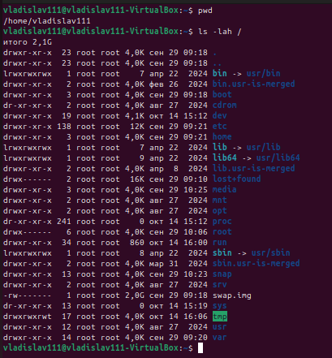

Результат: выведен текущий путь и список всех каталогов верхнего уровня с правами и размерами.

Что такое корневой каталог, чем абсолютный путь отличается от относительного.

Вывод: / — начало файловой системы. Абсолютный путь идёт от /, относительный — от текущего каталога.

## Домашний каталог

Команды:

```bash
cd ~, pwd, ls -a
```

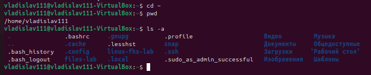

Результат: переход в домашний каталог, показан путь и все файлы, включая скрытые.

Где находится домашний каталог, что такое скрытые файлы.

Вывод: ~ = /home/пользователь. Скрытые файлы начинаются с точки.

## Каталог /etc

Команды:

```bash
cat /etc/os-release; getent passwd
```

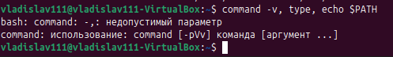

Результат: показана версия ОС и список пользователей с UID, домашними каталогами и оболочками.

Версия системы, UID, домашний каталог и оболочка.

Вывод: /etc хранит конфиги системы. В passwd видно, что у root UID=0, у обычных — от 1000.

## Программы и PATH

Команды:

```bash
command -v, type, echo $PATH
```

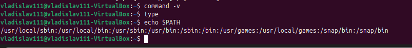

Результат: показано, что echo — встроенная команда оболочки, и выведен список каталогов из $PATH.

Как оболочка находит программу.

Вывод: оболочка ищет команды по каталогам из $PATH; встроенные (builtin) выполняются без поиска.

## Изменяемые данные

Команды:

```bash
ls /var; findmnt -T /run
```

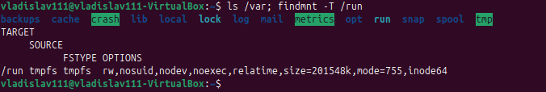

Результат: показано содержимое /var и файловая система, на которой смонтирован /run.

Назначение /var/lib, /var/log, /var/cache и /run.

Вывод: /var — для изменяемых данных: логи, кэш, базы. /run — временная ФС в памяти (tmpfs).

## Устройства

Команды:

```bash
ls -l /dev/null; echo $?
```

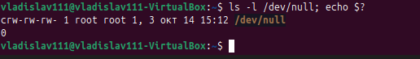

Результат: /dev/null — символьное устройство, код завершения предыдущей команды — 0.

Тип устройства и код завершения.

Вывод: /dev содержит файлы устройств. Код 0 — успех, любое другое число — ошибка.

## Файлы /proc

Команды:

```bash
cat /proc/uptime; cp; sleep 5
```

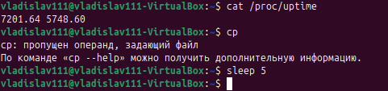

Результат: значение uptime в файле копии осталось старым.

Почему копия не меняется.

Вывод: /proc — виртуальная ФС. Копия — обычный файл, не связанный с ядром, поэтому не обновляется.

## Сетевые интерфейсы

Команды:

```bash
ls /sys/class/net
```

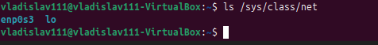

Результат: показаны сетевые интерфейсы системы.

Какие интерфейсы есть в системе.

Вывод: /sys — интерфейс к ядру. lo — loopback, enp0s3 — физический адаптер.

## inode и ссылки

Команды:

```bash
ls -li; rm data/info.txt; cat info-link.txt
```

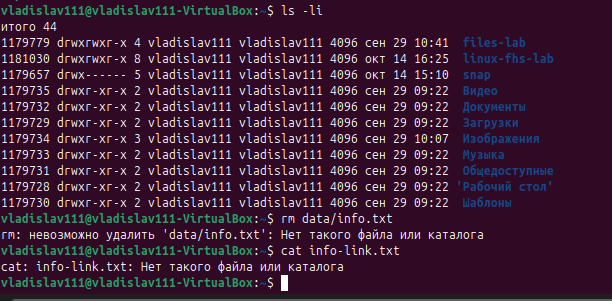

Результат: показаны inode файлов; после удаления оригинала симлинк перестал работать.

Чем жёсткая ссылка отличается от символической.

Вывод: жёсткая ссылка — то же inode, символическая — путь к файлу.

## Место на диске

Команды:

```bash
findmnt /; df -h .; du -sh data
```

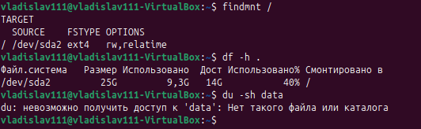

Результат: показан корневой раздел, свободное место и размер каталог

Чем df отличается от du.

Вывод: df — свободное место на ФС; du — сколько занимает конкретный каталог.

## Монтирование tmpfs

Команды:

```bash
findmnt -T mount-demo
```

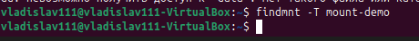

Результат: поверх каталога примонтирована tmpfs — старые файлы скрылись.

Почему before.txt перестал быть виден.

Вывод: монтирование закрывает старое содержимое. Файл остался на диске, но не виден через точку монтирования.

## Отключение tmpfs

Команды:

```bash
cat mount-demo/before.txt
```

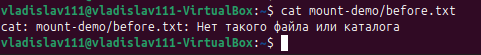

Результат: после размонтирования tmpfs снова видно before.txt, а inside.txt исчез.

Что стало с inside.txt.

Вывод: inside.txt жил в tmpfs (в памяти) и удалился при размонтировании. before.txt был на диске — вернулся.

## Файлы shop-api

Команды:

```bash
find model-root -type f
```

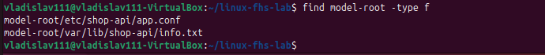

Результат: показан список всех файлов в дереве model-root.

Почему выбран каждый каталог.

Вывод: каталоги разделены по слоям приложения (модели, сервисы, роуты). -type f показывает только файлы.

## Размещение shop-api

| Файл | Каталог | Основание |
|---|---|---|
| Исполняемый файл | /usr/bin | FHS: исполняемые файлы для всех пользователей |
| Настройки | /etc | FHS: конфигурационные файлы системы |
| База данных	| /var/lib | FHS: изменяемые данные, специфичные для приложения |
| Журнал | /var/log | FHS: лог-файлы системы и приложений | 
| Номер процесса | /run	| FHS: временные файлы текущего запуска |

## Итоговая задача

| Путь | Оставить / Заменить | Правильный путь | Основание |
|---|---|---|---|
| `/home/admin/shop.log` | **Заменить** | `/var/log/shop-api/shop.log` | Логи приложения должны быть в `/var/log`, а не в домашнем каталоге пользователя. |
| `/usr/bin/config.json` | **Заменить** | `/etc/shop-api/config.json` | Конфиги хранятся в `/etc`, а не рядом с исполняемыми файлами. |
| `/tmp/database.db` | **Заменить** | `/var/lib/shop-api/database.db` | База данных — постоянные изменяемые данные. `/tmp` очищается при перезагрузке. |
| `/etc/shop-api/app.conf` | **Оставить** | `/etc/shop-api/app.conf` | Конфиг приложения в `/etc/<app>/` — правильно. |
| `/var/log/shop-api/access.log` | **Оставить** | `/var/log/shop-api/access.log` | Логи приложения в `/var/log/<app>/` — правильно. |
| `/var/lib/shop-api/database.db` | **Оставить** | `/var/lib/shop-api/database.db` | База данных в `/var/lib/<app>/` — правильно. |

# Таблица каталогов для службы backup-agent

| Файл | Каталог | Основание |
|---|---|---|
| Программа (исполняемый файл) | `/usr/bin/backup-agent` | FHS: исполняемые файлы для всех пользователей — в `/usr/bin` или `/usr/local/bin`. |
| Настройки | `/etc/backup-agent/config.conf` | FHS: конфиги системы и приложений — в `/etc/<app>/`. |
| Журнал | `/var/log/backup-agent/backup.log` | FHS: логи приложений — в `/var/log/<app>/`. |
| Список сделанных копий (каталог-индекс) | `/var/lib/backup-agent/index.db` | FHS: изменяемые данные приложения — в `/var/lib/<app>/`. |
| Номер процесса (PID) | `/run/backup-agent.pid` | FHS: PID-файлы текущего запуска — в `/run`. |
| Сами резервные копии | `/srv/backup/` (или `/mnt/backup/`) | FHS: данные, обслуживаемые системой (в т.ч. бэкапы), — в `/srv`. Внешний постоянный носитель монтируется в `/mnt` или отдельный `/srv/backup`. |

# Практическая работа

OS03.eyJ2IjoxLCJuIjoi0JPQsNCy0YDQuNC70L7QsiDQktC70LDQtNC40YHQu9Cw0LIg0JzQuNGF0LDQudC70L7QstC40YciLCJnIjoi0KDQn9CeLzEiLCJhIjpbIjUwNzg4NjIzIiwiMDE2NDMiLCIwMTIzNDUiLCIxMTEwMTAwMCIsIjAwMDAxMTExMSIsIjAyMzQ1Nzg5IiwiNzY1MDI3NjAiLCIwIiwiMCIsIjAiLCIwMTIiLCIwIiwiMDEiLCIwMTIzNDUwMSIsIjAxMjMiLCIwIiwiMCIsIjAxMjMiLCIxMTAwMDExIiwiMDEyMzQiLCIzNDU2IiwiMjM0IiwiMzQiLCIwIiwiMDEyMzQ1IiwiMyIsIjAyMTM0NSIsIjAiLCIwMTc4IiwiMDIiLCIwMzQiLCIwMzQiLCIxN2MiLCI3IiwiMTU2ODkiLCIwMTUiLCI0MDY1MjMiLCIyMjMxMTAwMCIsIjAiLCIwMTIzNDUiXSwicyI6MzMsInQiOjQwLCJtIjo0LCJkIjoiMjAyNi0xMC0xNFQxNTozMSIsInUiOjI3LCJvIjowLCJ4IjowfQ.3c96dcae75

## Перед сдачей

- [+] tmpfs отключена или ошибка описана.
- [+] Снимки открываются.
- [+] Результаты получены в моей системе.
- [+] Работа сохранена на внешнем носителе.