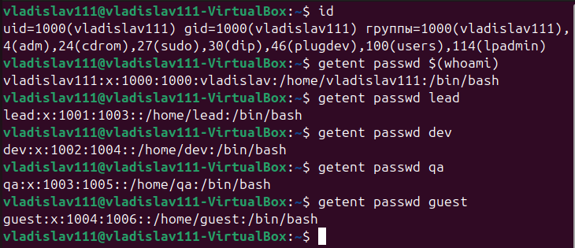
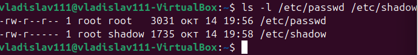
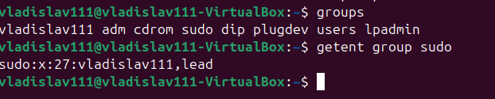
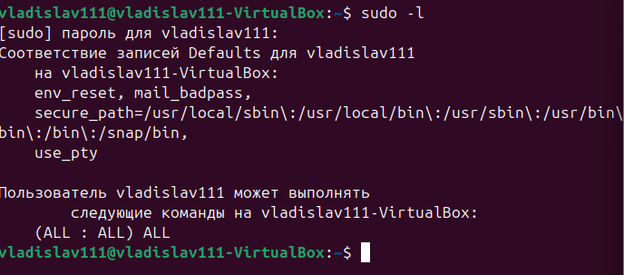
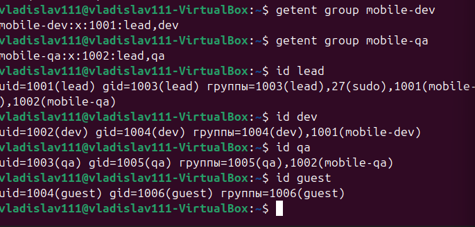
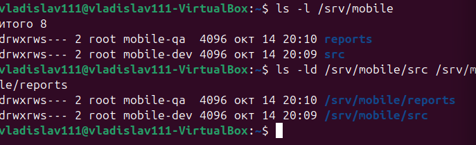
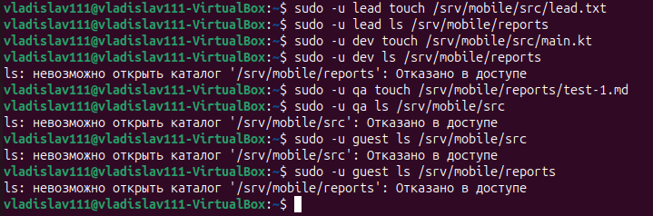
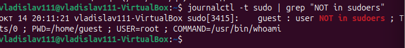

# Пользователи, группы и sudo · отчёт

ФИО: Гаврилов Владислав Михайлович
Группа: РПО/1
Дата: 14.10.2026
Среда: установленная Ubuntu

## Учётная запись

Команды:

```bash
id, getent passwd $(whoami)
```



Результат: id показывает UID, GID и группы пользователя; getent passwd $(whoami) возвращает строку из /etc/passwd.

Подпишите семь полей своей строки /etc/passwd.

Вывод: строка /etc/passwd состоит из 7 полей: имя, пароль (x), UID, GID, комментарий, домашний каталог, оболочка.

## passwd и shadow

Команды:

```bash
ls -l /etc/passwd /etc/shadow
```



Результат: /etc/passwd доступен на чтение всем, /etc/shadow — только root.

Почему shadow закрыт для остальных пользователей.

Вывод: shadow закрыт, потому что содержит хеши паролей. Если бы он был доступен всем, злоумышленник мог бы скачать хеши и подбирать пароли офлайн.

## Группы

Команды:

```bash
groups, getent group sudo
```



Результат: groups показывает все группы пользователя, getent group sudo — состав группы sudo.

Где основная группа, где дополнительные.

Вывод: первая группа в выводе id — основная (primary), остальные — дополнительные (supplementary). Права дают обе, но новые файлы создаются с основной группой.

## Правила sudo

Команды:

```bash
sudo -l
```



Результат: sudo -l показывает, какие команды разрешены пользователю.

Какое правило даёт вам права администратора.

Вывод: права администратора даёт правило (ALL : ALL) ALL — оно приходит через членство в группе sudo.

## Команда mobile-app

Команды:

```bash
getent group …, id lead dev qa guest
```



Результат: getent group mobile-dev mobile-qa и id lead dev qa guest показывают состав групп и членство.

Совпадают ли группы со схемой ролей.

Вывод: группы совпадают со схемой ролей: lead — в mobile-dev, mobile-qa, sudo; dev — в mobile-dev; qa — в mobile-qa; guest — только в личной группе.

## Каталоги проекта

Команды:

```bash
ls -l /srv/mobile
```



Результат: ls -ld /srv/mobile/src /srv/mobile/reports показывает права drwxrws---, группу mobile-dev / mobile-qa.

Что означает каждая цифра в 2770.

Вывод: 2770 = setgid (2) + владелец rwx (7) + группа rwx (7) + остальные нет доступа (0). Setgid нужен, чтобы новые файлы наследовали группу каталога.

## Тесты доступа

Команды:

```bash
sudo -u … ls / touch
```



Результат: lead — везде разрешено; dev — только src; qa — только reports; guest — везде Permission denied.

Результаты таблицы тестов доступа.

Вывод: результаты совпадают с ожидаемыми. Принцип минимальных привилегий соблюдён.

## Отказ sudo в журнале

Команды:

```bash
journalctl -t sudo | grep "NOT in sudoers"
```



Результат: в журнале запись guest : user NOT in sudoers ; TTY=… ; COMMAND=/usr/bin/whoami.

Кто, когда и какую команду пытался выполнить.

Вывод: guest не входит в sudo, попытка sudo whoami отклонена и зафиксирована в журнале. Это пример работы принципа минимальных привилегий.

# Практическая работа

OS45.eyJ2IjoxLCJuIjoi0JPQsNCy0YDQuNC70L7QsiDQktC70LDQtNC40YHQu9Cw0LIiLCJnIjoi0KDQn9CeLzEiLCJhIjpbIjAxMiIsIjM1IiwiMCIsIjAyNCIsIjAxMjM1NiIsIjAxMjM0IiwiMCIsIjAxMiIsIjAxNCIsIjM1NjdhIiwiMTIzNDU2IiwiOSIsIjAiLCIwIiwiMDAwMTExMiIsIjAxMjM0NSIsIjAxMjM0NSIsIjAiLCIyIiwiMjIyMDM0NDAwIiwiMDEyMzQ1NiIsIjAxNDI0IiwiMCIsIjAxMiIsIjAiLCIyIiwiNzExIiwiMDIxMyIsIjAwMTExMTAiLCIwIiwiMDEyMzQiLCIwMTIzIiwiMDEyIiwiMjM0NSIsIjAxMTAwMDEiLCIwIiwiMDEyIiwiMTM0IiwiMCIsIjEzIl0sInMiOjI3LCJ0Ijo0MCwibSI6NCwiZCI6IjIwMjYtMTAtMTRUMTg6MTMiLCJ1IjoyMiwibyI6MCwieCI6MH0.5cad882a92

## Перед сдачей

- [+] Проверка: 21 из 21.
- [+] access-tests.md заполнен.
- [+] Учебные учётные записи удалены.