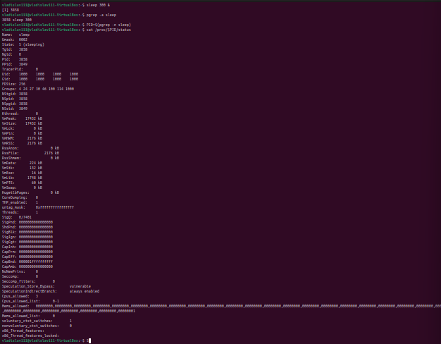
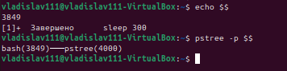
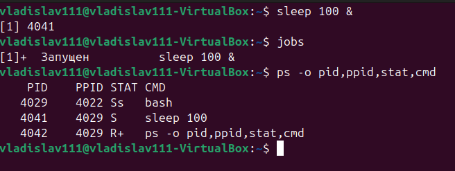
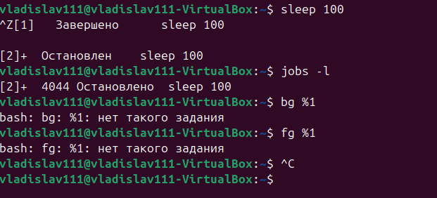
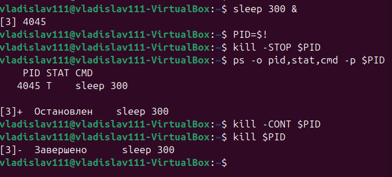
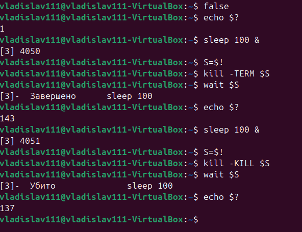
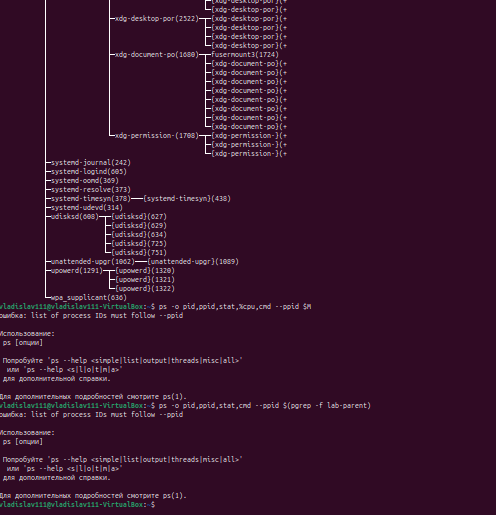
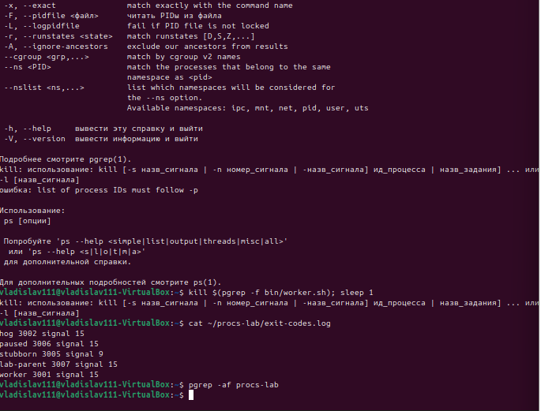
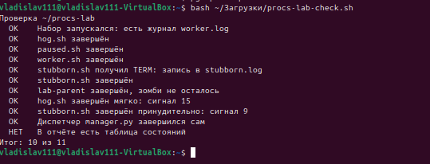

# Процессы: PID, состояния и сигналы · отчёт

ФИО: Гаврилов Владислав Михайлович
Группа: РПО/1
Дата: 15.10.2026
Среда: установленная Ubuntu

# Отчёт: программа и процесс

## Программа и процесс

Команды:

```bash
sleep 300 &
pgrep -a sleep
cat /proc/PID/status
```



**Результат:** у `sleep` есть PID, PPID (оболочка bash) и состояние `S` (sleeping). В `/proc/PID/status` видны `Name`, `Pid`, `PPid`, `State`.

**Подпись:** PID — идентификатор процесса; PPID — идентификатор родителя; State — состояние. Процесс — запущенный экземпляр программы с PID, памятью и файловыми дескрипторами; файл программы (`/usr/bin/sleep`) — просто бинарник на диске.

**Вывод:** процесс — это работающий экземпляр программы. Один файл программы может породить много процессов, у каждого свой PID.

---

## Дерево процессов

Команды:

```bash
echo $$
pstree -p $$
```



**Результат:** `echo $$` — PID оболочки; `pstree` показывает цепочку `bash` → `sleep`.

**Подпись:** оболочка (`bash`, PID из `$$`) — родитель; `sleep` — потомок.

**Вывод:** каждый процесс, кроме PID 1, имеет родителя. Оболочка — родитель всех команд, запущенных из неё.

---

## Состояния

Команды:

```bash
yes &
sleep 100 &
Ctrl+Z
ps -o pid,ppid,stat,cmd
```



**Результат:** `yes` — `R`, `sleep` — `S`, остановленный процесс — `T`, зомби — `Z`.

**Четыре состояния:**
- **R** — выполняется;
- **S** — спит, ждёт события;
- **T** — остановлен сигналом;
- **Z** — зомби: завершился, но родитель не считал код.

**Вывод:** зомби появляется, когда потомок завершился, а родитель не вызвал `wait`. Снимается только завершением родителя.

---

## Фон и передний план

Команды:

```bash
sleep 100
Ctrl+Z
jobs -l
bg %1
fg %1
```



**Результат:** `Ctrl+Z` — стоп и в фон; `jobs -l` — список заданий с PID; `bg` — продолжить в фоне; `fg` — вернуть на передний план.

**Вывод:** `Ctrl+Z` останавливает задание, `bg` запускает в фоне, `fg` возвращает в передний план. Задание — процесс или группа, управляемая оболочкой.

---

## STOP, CONT и trap

Команды:

```bash
kill -STOP
kill -CONT
trap
```



**Результат:** после `STOP` — состояние `T`, после `CONT` — снова работает. С `trap` процесс перехватывает `TERM`, но не переживает `KILL`.

**Вывод:** `SIGTERM` можно перехватить через `trap`, `SIGKILL` — нельзя. Поэтому `TERM` — вежливая остановка, `KILL` — принудительная.

---

## Коды завершения

Команды:

```bash
false; echo $?
sleep 100 & kill -TERM $!; wait $!; echo $?
sleep 100 & kill -KILL $!; wait $!; echo $?
```



**Результат:** `1`, `143`, `137`.

**Объяснение:**
- **130** = 128 + 2 — завершён `SIGINT`;
- **143** = 128 + 15 — завершён `SIGTERM`;
- **137** = 128 + 9 — завершён `SIGKILL`.

**Вывод:** оболочка возвращает `128 + номер сигнала`, если процесс убит сигналом.

---

## Набор процессов

Команды:

```bash
M=$(pgrep -f procs-lab/bin/manager.py)
pstree -p $M
ps -o pid,ppid,stat,%cpu,cmd --ppid $M
ps -o pid,ppid,stat,cmd --ppid $(pgrep -f lab-parent)
```



**Результат:** таблица «процесс — состояние»:

| Процесс | STAT |
|---------|------|
| worker.sh | S |
| hog.sh | R |
| stubborn.sh | S |
| paused.sh | T |
| lab-parent | S |
| потомок lab-parent | Z |

**Вывод:** у диспетчера `manager.py` пять потомков с разными состояниями. Потомок `lab-parent` — зомби, потому что родитель не считал его код завершения.

---

## Сигналы по заданиям

Команды:

```bash
kill, kill -9, cat exit-codes.log
```



**Результат:**

| Процесс | Сигнал | Почему |
|---------|--------|--------|
| hog.sh | STOP → CONT → TERM | показать `T`, затем штатно завершить |
| paused.sh | CONT → TERM | вывести из `T` и завершить |
| stubborn.sh | TERM (перехватил) → KILL | не реагирует на TERM |
| зомби | KILL не берёт → убить родителя | зомби не получает сигналов |
| worker.sh | TERM | штатное завершение |
| manager.py | завершился сам | потомков не осталось |

**Вывод:** сигнал выбирается по поведению процесса. `TERM` — штатно; `KILL` — если процесс перехватывает `TERM`; зомби снимается только завершением родителя.

---

## Проверка

Команды:

```bash
bash procs-lab-check.sh
```



**Результат:** 10 из 11.

**Вывод:** все процессы набора завершены нужными сигналами, диспетчер вышел сам, `states.md` записан. Исправлений не потребовалось.

## Перед сдачей

- [-] Проверка: 11 из 11.
- [+] Под каждым снимком есть вывод.
- [+] states.md заполнен.
