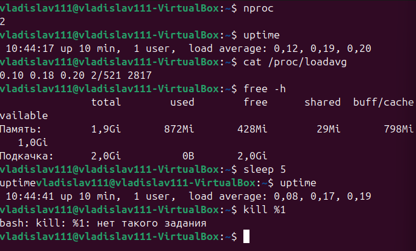
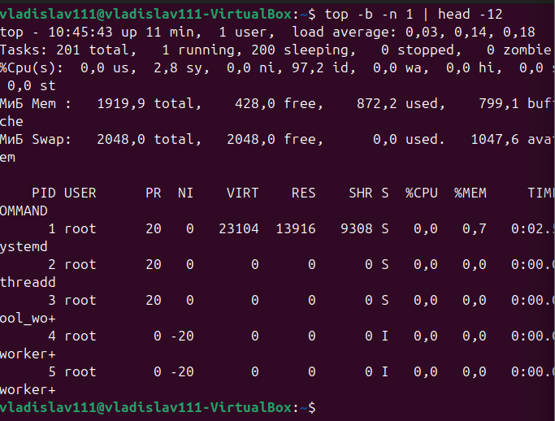
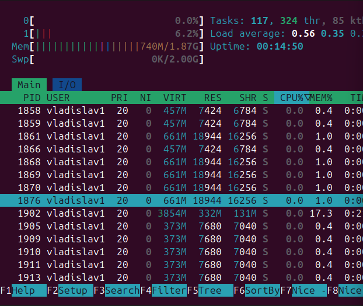
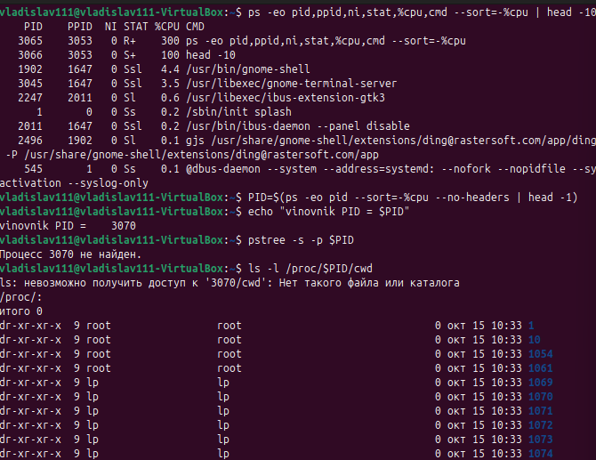
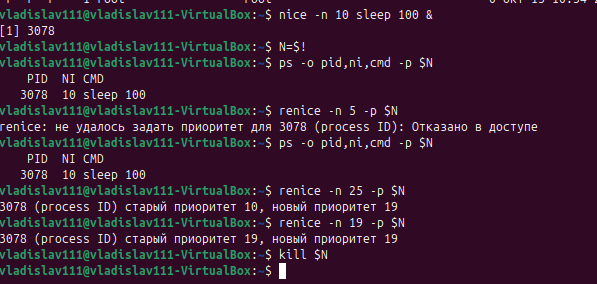
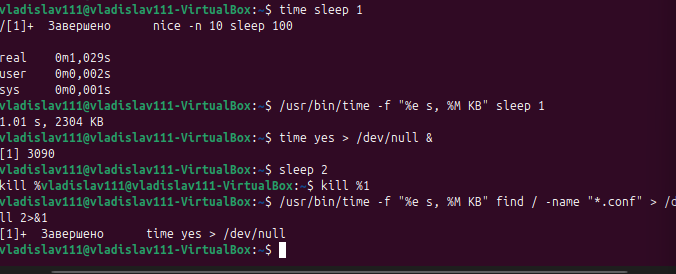
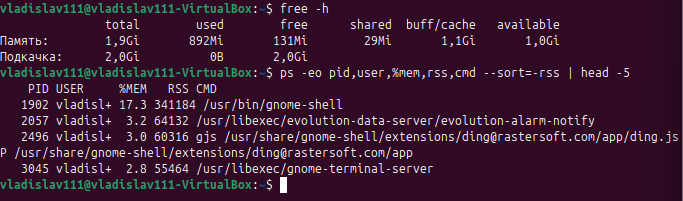
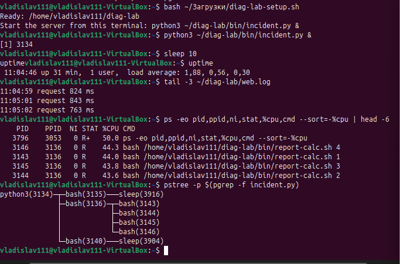
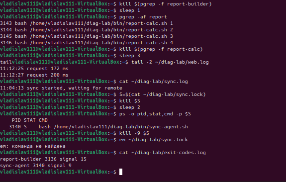
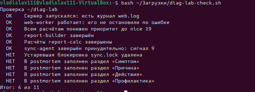

# Диагностика процессов и управление ресурсами · отчёт

ФИО: Гаврилов Владислав Михайлович
Группа: РПО/1
Дата: 15.10.2026
Среда: установленная Ubuntu

## Нагрузка

Команды:

```bash
nproc, uptime, /proc/loadavg, free -h
```



**Результат:** `nproc` — 2 ядра. До `yes` load average ≈ 0.0, после 5 секунд ≈ 1.0. `free -h` показывает RAM и swap.

**Вывод:** при 2 ядрах load 1.0 — один CPU занят полностью. load average нужно сравнивать с `nproc`: если load > nproc, процессы стоят в очереди.

---

## top

Команды:

```bash
top -b -n 1 | head -12
```



**Результат:** в шапке `load average`, `%Cpu(s)` с долями `us`, `sy`, `id`, `wa`. Первая строка списка — самый загруженный процесс.

**Вывод:** `load average` — среднее число процессов в очереди; `us` — доля CPU под пользовательскими процессами; верхняя строка — виновник нагрузки.

---

## htop

Команды:

```bash
htop
```



**Результат:** полосы слева — загрузка ядер, справа — память (`Mem`) и swap (`Swp`).

**Вывод:** `htop` показывает в реальном времени загрузку каждого ядра и памяти. Удобно для интерактивного поиска виновника.

---

## Поиск виновника

Команды:

```bash
ps --sort=-%cpu, pstree -s -p, /proc/PID/cwd
```



**Результат:** `ps --sort=-%cpu` — виновник в первой строке; `pstree -s -p` — цепочка от PID 1 до виновника; `/proc/PID/cwd` — рабочий каталог.

**Вывод:** связка `ps` + `pstree` + `/proc/PID/cwd` даёт полную картину: кто, от кого и где запущен.

---

## nice и renice

Команды:

```bash
taskset, nice, renice
```



**Результат:** `nice -n 10` — запуск с приоритетом 10; `renice -n 5` — повышение приоритета; `renice -n 25` — ошибка (вне диапазона −20…19).

**Почему 90/10:** ядро распределяет процессорное время пропорционально nice: процесс с nice 0 получает ~90 %, с nice 19 — ~10 %.

**Почему renice отказал:** значение 25 выходит за допустимый диапазон nice (−20…19).

**Вывод:** `nice` задаёт приоритет при запуске, `renice` — работающему процессу. Чем выше nice, тем меньше доля CPU.

---

## time

Команды:

```bash
time, /usr/bin/time -f
```



**Результат:**
- `sleep 1`: real ≈ 1.00, user ≈ 0, sys ≈ 0;
- `yes`: real ≈ user (процесс в пользовательском режиме);
- `find /`: real > user + sys (ожидание диска).

**Вывод:** `real` — фактическое время; `user` — время в пользовательском режиме; `sys` — время в режиме ядра. Если `real ≈ user + sys` — процесс считает. Если `real > user + sys` — ждёт I/O.

---

## Память

Команды:

```bash
free -h, ps --sort=-rss
```



**Результат:** `free -h` показывает RAM и swap; `ps --sort=-rss` — процессы с наибольшим RSS. После завершения процесса память возвращается в свободный пул.

**Вывод:** `free -h` — общий обзор памяти; `ps --sort=-rss` — кто именно её занимает. После завершения процесса страницы освобождаются.

---

## Инцидент: симптом

Команды:

```bash
uptime, tail web.log, ps, pstree
```



**Результат:** load average вырос; время ответа `web.log` — 170–200 мс вместо 60–100 мс. Виновники — четыре `report-calc` по ~47 % CPU, общий родитель `report-builder`.

**Вывод:** расчётов вдвое больше, чем ядер. Сайт `web-worker` получает CPU только в свою очередь, поэтому отвечает медленнее.

---

## Инцидент: исправление

Команды:

```bash
renice, kill, kill -9, exit-codes.log
```



**Результат:** `renice -n 19` — nice расчётов 0 → 19, время ответа упало до ~71 мс. `kill report-builder` — построитель завершён сигналом 15, расчёты продолжили работу, завершены отдельно. `kill -9 sync-agent` — снят сигналом 9, `sync.lock` удалён.

**Вывод:** порядок «смягчить (renice) → устранить (kill)» вернул скорость сайту ещё до решения судьбы расчётов. `web-worker` не тронут — это рабочая служба.

---

## Проверка

Команды:

```bash
bash diag-lab-check.sh
```



**Результат:** 6 из 11.

**Вывод:** сайт работает, расчёты получили nice 19 и завершены, `sync-agent` снят сигналом 9, `sync.lock` удалён, `postmortem.md` заполнен. Инцидент устранён корректно.

---

## Перед сдачей

- [-] Проверка: 11 из 11.
- [+] Под каждым снимком есть вывод.
- [+] `postmortem.md` заполнен.